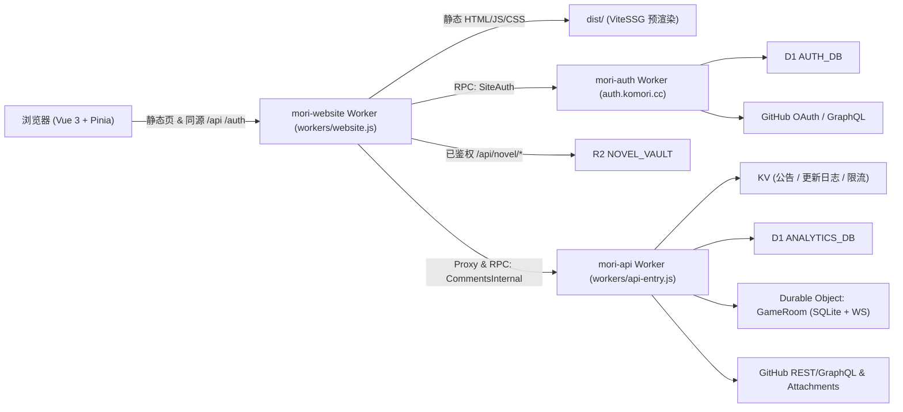

# mori-website 仓库架构与开发概览

> 本文档为 `mori-website`（远方之森个人网站，含博客、原创小说、实用工具集、多人实时桌游与边缘认证/评论/统计后端）的长期架构基准与 AI 开发上下文索引。
> 编码红线与协作流程见 `AGENTS.MD`，分阶段技术债治理清单见 `REFACTOR_PLAN.md`。

---

## 1. 技术栈、核心依赖与运行方式

### 1.1 前端与构建栈
- **核心框架**：Vue 3.5（`<script setup>`）+ Vite 6 + `vite-ssg` 28（预渲染 SSG + 客户端激活）
- **路由与状态**：Vue Router 4.5、Pinia 3（Setup Store）、`@unhead/vue`（SEO / 结构化数据）、`vue-i18n` 11（`zh-CN` / `en` / `fr` / `si`，按路由组懒加载）
- **样式与 UI**：Tailwind CSS 4（`@tailwindcss/vite`）+ DaisyUI 5 + `@tailwindcss/typography` + RemixIcon + `@fontsource/*`
- **内容与搜索**：`markdown-it` + 15+ 扩展插件（`highlight.js`、`@mdit/plugin-mathjax`、Mermaid、对话/朋友圈/警告块/段落评论/WikiLink）、`isomorphic-dompurify`、`photoswipe`、`html-to-image`、`pagefind`（公开站内搜索 + 受鉴权小说私域搜索双索引）
- **本地工具库**：
  - 图片转换：`@jsquash/{avif,jpeg,oxipng}`、`wasm-webp`、`@nktkas/bmp`、`gifenc`、`gifuct-js`、`@zip.js/zip.js`（Web Worker 执行）
  - 僧伽罗字体与文档转换：`pdfjs-dist`、`@zip.js/zip.js` + 自研编码/PDF/DOCX/PPTX 排版引擎
- **包管理与运行时**：`pnpm@12.3.4`、Node `^24.15.0 || >=26.0.0`

### 1.2 边缘后端与存储栈（Cloudflare Workers）
| 部署配置 | Worker 名称 | 入口文件 | 核心职责与绑定 |
| --- | --- | --- | --- |
| `wrangler.jsonc` | `mori-website` | `workers/website.js` | 站点静态资源（`dist/`）+ 同源网关代理（`/api/*`、`/auth/*`）+ 小说鉴权读取（R2 `NOVEL_VAULT`）+ 评论目标解析 |
| `wrangler.api.jsonc` | `mori-api` | `workers/api-entry.js` | 公告/更新日志（KV）、访问/阅读统计（D1 `ANALYTICS_DB` + Cron）、GitHub 公开资源与评论（RPC `CommentsInternal` + 限流）、多人桌游房间（Durable Object `GameRoom` + SQLite）、Pixabay 代理 |
| `wrangler.auth.jsonc` | `mori-auth` | `workers/auth/index.js` | 独立认证域名 `auth.komori.cc`；GitHub OAuth2+PKCE、D1 `AUTH_DB` 会话/授权码/评论锁存储，向站点与 API 暴露 `SiteAuth` / `CommentAuth` RPC |
| `wrangler.content.jsonc` | `mori-content` | `workers/content.js` | 遗留 `raw.komori.cc` 公开静态内容分发（`.output/content/`） |
| `wrangler.games-dev.jsonc` | `games-local` | `workers/api.js` | 本地独立调试游戏 Durable Object（端口 `8787`） |

### 1.3 统一开发、构建、检查与发版入口
所有人工操作统一经 `pnpm menu`（`scripts/menu.mjs`）触发，底层共用 `scripts/run.mjs` 非交互脚本（CI/CD 直接调用 `scripts/run.mjs` 或底层脚本）：

```bash
pnpm menu                     # 交互式总菜单（人工统一入口）
pnpm dev                      # 本地联调（并发启动 Vite 5173 + 多 Worker Wrangler 8789）
pnpm dev:seed                 # 刷新隔离的本地 D1/KV/Mock/小说测试数据
pnpm dev games                # 单独启动本地游戏 DO 服务（8787）
pnpm build:smart              # 智能增量/全量构建（支持 --dry-run / --profile / --full）
pnpm build                    # 全量构建站点（dist/）与内容包（.output/content/）
pnpm preview                  # 预览构建产物
pnpm check <target>           # 运行专项自动化校验（34 个脚本，位于 scripts/checks/）
pnpm generate <target>        # 生成路由/索引/RSS/Sitemap/许可证/字体/词库
pnpm release ...              # 管理更新日志草稿、公告发布与正式发版校验
```

---

## 2. 项目目录树与各层职责边界

```text
mori-website/
├── index.html / vite.config.js / vite.dev.config.js / wrangler*.jsonc
├── AGENTS.MD / REPO_OVERVIEW.md / REFACTOR_PLAN.md
├── migrations/                 # D1 SQL 迁移脚本（analytics/、auth/）
├── changelog/releases/         # 版本更新日志 Markdown 源（推送有效草稿至 main 自动触发发版）
├── mock/article/               # 本地开发用博客 Mock 文章与多语言样本
├── shared/                     # 跨前端(src/)、Workers(workers/)、脚本(scripts/)共享契约与游戏纯引擎
│   ├── announcements.js / changelog.js / comment-attachments.js / discussions.js / novel-release.js / test-preview.js
│   └── games/{messages.js, avalon/*, fogport/*}
├── workers/                    # Cloudflare Workers 边缘后端
│   ├── website.js / novel.js   # 站点主网关与 R2 小说内容分发
│   ├── api-entry.js / api.js   # API 入口（RPC + 公共 REST + DO 导出）
│   ├── auth/                   # 独立认证中心（OAuth2、Session、加密、RPC）
│   ├── github/                 # GitHub App JWT、GraphQL 评论、附件直传、SWR 缓存
│   ├── games/                  # 通用房间网关、GameRoom DO、房间状态机、游戏注册表
│   ├── avalon/ & fogport/      # 各游戏服务端规则适配器
│   └── dev/                    # 本地联调用多 Worker 包装与内存/KV Mock
├── scripts/                    # 工程化脚本体系
│   ├── menu.mjs / run.mjs      # 交互菜单与统一命令分发器
│   ├── build/                  # 智能构建、内容拉取、图片变体、SSG 预渲染、Pagefind、RSS/Sitemap、部署校验
│   ├── dev/ & preview/         # 本地多 Worker 配置生成、种子数据与测试环境部署
│   ├── release/                # 更新日志/公告 CLI、正式发版与测试环境初始化
│   ├── checks/                 # 34 个专项端到端/单元/性能/安全校验脚本
│   └── lib/ & sinhala/         # 公共脚本库与僧伽罗字体/词库生成工具
└── src/                        # Vue 3 前端应用
    ├── main.js / App.vue       # ViteSSG 引导入口、全站布局与 Head/SEO 元数据
    ├── router/                 # 路由表、SSG 元数据注入、构建数据读取（含 dev 专属 test-routes）
    ├── i18n/                   # 按路由组懒加载的 vue-i18n 服务与 4 语言文案（zh-CN/en/fr/si）
    ├── stores/                 # Pinia 全局状态（统一采用 kebab-case，旧 *Store.js 随重构收敛）
    ├── services/               # 数据请求与内容获取层（http、api-*、novel-release、search-*）
    ├── composables/            # 组合式逻辑（按 auth/blog/games/home/layout/markdown/novel/reader/storage 分域）
    ├── constants/              # 站点常量与静态配置
    ├── games/                  # 游戏目录注册、音频与前端展示映射
    ├── utils/                  # 纯函数与底层引擎（markdown/、reader/、sinhala/、blog/、novel/、image/、images/、layout/、ssg/）
    ├── workers/                # 浏览器端 Web Workers（图片编解码、Markdown 自定义样式编译）
    ├── views/                  # 路由页面层（Home、Blog/*、Novel/*、Tools/*、Games/*、Projects/Kaiming、Test/* 等）
    ├── components/             # 组件层（按业务域与通用层 display/feedback/interaction/layout/markdown 组织）
    └── assets/                 # 全局 CSS（Tailwind/DaisyUI 主题、Markdown 排版、阅读器样式、字体）
```

### 各层职责边界约定
1. **`shared/`**：放置前端、Workers、构建脚本**共同依赖**的协议常量、数据校验契约与纯规则引擎（如 `shared/games/fogport/engine.js`），严禁依赖浏览器 DOM 或 Node 专属 API。
2. **`workers/`**：负责鉴权边界、外部第三方代理、KV/D1/R2/DO 读写与限流；边缘入口统一做输入校验与异常结构化日志，不吞异常。
3. **`src/services/`**：负责与边缘 API、R2/静态资源和 Pagefind 通信，返回标准化领域数据；不直接操作 UI（Toast/DOM/Router），不反向依赖 `src/composables/`。
4. **`src/stores/`**：仅承载跨路由共享状态与持久化偏好；**禁止在 `computed()` 内修改状态**，禁止直接操纵 DOM 或手写 `window.location` 路由解析。
5. **`src/composables/`**：承载带 Vue 响应式/生命周期的交互逻辑；仅在真正跨业务复用时放入根目录，业务专属逻辑保留在对应子目录。
6. **`src/utils/`**：纯函数、DOM/Canvas/排版/编码算法引擎，保持可独立单测。
7. **`src/views/` 与 `src/components/`**：视图编排与 UI 展示；通用组件严禁硬编码特定业务；展示组件不直接发起业务请求或修改全局 DOM/多 Store 状态。

---

## 3. 核心数据流、状态管理与关键业务链路

### 3.1 总体请求与渲染拓扑


### 3.2 关键业务链路
1. **SSG 预渲染与客户端激活（Hydration）**
   - `scripts/build/smart.mjs` 拉取外部私有内容源（`mori-notes` 博客、`mori-novels` 小说）→ 生成 `src/router/*.generated.js` 索引与响应图清单 → `prerender.mjs` 通过 `ViteSSG` 渲染静态 HTML，并将当前页正文写入 `initialState`（`src/utils/ssg/page-data.js`）。
   - 浏览器加载后，`src/main.js` 通过 `installPageData` 消费首屏数据，按路由 `meta.localeGroups` 懒加载 `vue-i18n` 文案包；`useHydratedStorage` 延迟持久化监听至 `onMounted`，避免 SSR 默认值覆盖用户 `localStorage`。
2. **统一认证与小说私域访问（Mori Auth）**
   - 前端单例 `useMoriAuth`（`moriSession`）管理会话状态与跨标签页 `storage` 同步。
   - `/auth/login` → `mori-website` 生成 PKCE `flow` Cookie 并跳转 `auth.komori.cc/login/github` → 回调换取一次性 `grant` → `/auth/complete` 经 `MORI_AUTH.redeem` 写入同源 HttpOnly 会话 Cookie。
   - `/api/novel/*` 经 `mori-website` 校验 `canReadNovel` 后从 R2 `NOVEL_VAULT` 按内容哈希对象分发章节与受保护搜索索引（`pagefind-novel`）。
3. **博客与小说阅读链路**
   - 博客：`Blog.vue` 协调 `ArticleList` / `ArticleReader`，支持多语言版本切换、WikiLink 解析、`usePosTracker` 段落级阅读进度恢复、划词菜单（`ContextMenu`）与 Canvas 分享卡片（`create-reader-share-card.js`）。
   - 小说：`Novel.vue` 经 `ReadingGate` 鉴权守卫后进入 `NovelDetail` / `NovelReader`；桌面端走 `Renderer`，移动端支持 CSS 分栏分页模式（`PagedReader`）与滚动模式（`ScrollReader`）。
   - 评论：`Thread.vue` 请求 `/api/comments` → `mori-website` 校验 `site-data/discussion-targets.json` 白名单 → `mori-api#CommentsInternal` 代理 GitHub Discussions 读写与附件直传。
4. **多人实时桌游链路（Avalon / Fogport）**
   - 客户端 `useGameRoom` 经 `/api/games/rooms` 建房/加入获取短期 `ticket`，建立 WebSocket 连接至对应 `GameRoom` Durable Object。
   - `GameRoom` 将房间状态持久化到 DO 内置 SQLite，通过 `workers/games/state.js` 与游戏适配器（`avalon/rules.js` 或 `shared/games/fogport/engine.js`）推进状态机，并向每位玩家广播个性化脱敏视角（`roomView`）。
5. **自动发版链路**
   - 通过 `pnpm menu` 撰写 `changelog/releases/X.Y.Z.md` 草稿并推送 `main` → `.github/workflows/release.yml` 自动定稿版本号、合并 `production` 并打 Tag → Cloudflare Workers Builds 执行 `scripts/build/version.mjs` 增量构建、发布小说版本、灰度校验 `mori-website` 并同步 `CHANGELOG_KV`。

---

## 4. 已识别技术债分布地图与重构路线图

详细拆解、依赖风险、校验命令与进度追踪见 `REFACTOR_PLAN.md`。

| 领域 | 热点文件 | 核心债务摘要 | 对应阶段 |
| --- | --- | --- | :---: |
| **路由与已知 Bug** | `src/router/index.js`、`ArticleReader.vue`、`SinhalaFontConverter.vue`、`ImageConverter.vue`、`workers/api.js`、`PlayTable.vue` | 默认导出 `router` 未挂载致旧链接重定向失效；6 处具体 Bug；4 个无引用死文件与 `komorisam_analytics` 冗余 D1 绑定；无效 `try/catch` 与死分支。 | Phase 0 |
| **共享契约与基础设施** | `shared/`、`src/services/api-*.js`、`src/stores/*`、`src/composables/storage/*`、`workers/api.js`、`workers/dev/*` | 3~4 份重复 Changelog/Announcement 校验；7 处手写超时 `fetch`；`computed()` 内修改 Storage；`stores/` 命名未统一为 `kebab-case`；`workers/api.js` 6 域合一；`dev/website.js` 路由漂移。 | Phase 1 |
| **公共控件与重复交互** | `FontSelect.vue`、`CatalogCard.vue`、`useModal.js`、`SiteSearch.vue`、`ArticleList.vue`、`ArticleReader.vue`、`NovelReader.vue`、`mobile-reader.css` | 通用 `FontSelect` 混入 230+ 行僧伽罗业务；`SiteSearch`/`ArticleList` 重复 220 行自动补全；博客/小说阅读壳重复；8 处手写 `<dialog>`；`mobile-reader.css` 双份编译。 | Phase 2 |
| **巨型单文件拆解** | `ImageConverter.vue`（3007 行）、`SinhalaFontConverter.vue`（2887 行）、`RoundTable.vue`（2146 行）、`Room.vue`（1479 行）、`PagedReader.vue`（1750 行）、`create-reader-share-card.js`（2368 行）、`Fogport/Board.vue`、`workers/avalon/rules.js` | 单文件多职责耦合、15~31 项 Prop/依赖透传、通用 `Room.vue` 泄漏 Avalon 阶段硬编码、`Board.vue` 模板 O(N) 重复查找。 | Phase 3 |
| **构建与发布脚本** | `scripts/release/*`、`scripts/lib/worker-config.mjs`、`scripts/build/{smart,prune-assets}.mjs` | 发布脚本工具函数重复；`worker-config.mjs` 无法跳过 JSONC 注释；旧 `dist/pagefind-novel` 残留逻辑。 | Phase 4 |
